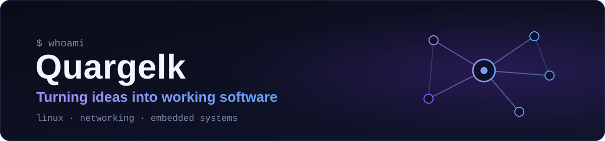
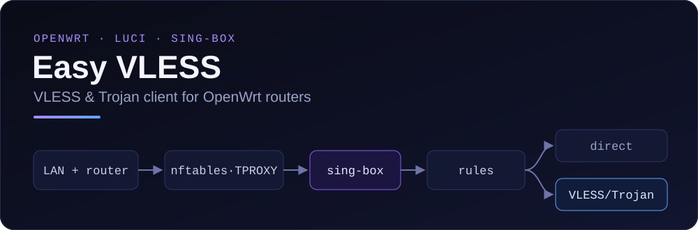

I write software for Linux-based routers and the networks behind them. 
My main project is <a href="https://github.com/quargelk/easy-vless"><b>Easy VLESS</b></a>, a VLESS and Trojan client for OpenWrt. 
Interested in Linux, networking and embedded systems.

## Featured project

### [Easy VLESS](https://github.com/quargelk/easy-vless)

Easy VLESS puts a whole home network behind your own VLESS or Trojan server, and rules decide which traffic goes through it and which goes direct. You install it once on an OpenWrt router instead of configuring every phone, laptop and TV, then manage everything from the router's LuCI web interface, which can also explain *why* a particular site takes the route it does.

- **Protocols:** VLESS and Trojan over TCP, WebSocket, gRPC and HTTPUpgrade, with TLS, Reality and uTLS
- **Transparent proxying:** for LAN devices and the router itself through nftables (TPROXY or REDIRECT), powered by [sing-box](https://sing-box.sagernet.org/)
- **Rule-based routing:** by domain, IP, port, protocol and source, with ready-made rule sets and a separate target for each rule
- **Subscriptions:** link lists and Clash YAML, with automatic updates
- **Diagnostics:** Route Explain plus connection, DNS and forwarding checks that give a reason for every result
- **Maintenance:** a setup wizard that rolls back on failure, backup and restore, and in-place updates verified against the release's `SHA256SUMS`
- **Interface:** Russian and English

CI tests six OpenWrt 24.10 images covering x86-64, ARMv8, ARMv7 and MIPS. The project has also been tested on a Cudy TR3000 v1 router.
Requires OpenWrt 24.10.x with `opkg`. IPv6 TProxy and sing-box JSON subscriptions are experimental.

**[Repository](https://github.com/quargelk/easy-vless)** · **[Install](https://github.com/quargelk/easy-vless#%D1%83%D1%81%D1%82%D0%B0%D0%BD%D0%BE%D0%B2%D0%BA%D0%B0)** · **[Releases](https://github.com/quargelk/easy-vless/releases)** · **[Technical docs](https://github.com/quargelk/easy-vless/blob/main/docs/technical.md)** · **[Issues](https://github.com/quargelk/easy-vless/issues)**

The documentation is written in Russian. Parts of the runtime are derived from <a href="https://github.com/Openwrt-Passwall/openwrt-passwall2">PassWall2</a>.

## Tech I work with

| Area | In practice |
| --- | --- |
| **Languages** | Lua and Shell for the router runtime, JavaScript for the LuCI interface, Python for tests and build tooling |
| **Platform** | OpenWrt, LuCI, UCI, rpcd/ubus, opkg packages |
| **Networking** | sing-box, nftables, TPROXY, dnsmasq |
| **Delivery** | GitHub Actions, with a Docker and QEMU test matrix across OpenWrt architectures |

## GitHub activity

  
  

## Contact

GitHub is the best place to reach me. For Easy VLESS bugs and questions, please [open an issue](https://github.com/quargelk/easy-vless/issues).

