<picture><source media="(prefers-color-scheme: dark)" srcset="assets/hero-dark.svg"></picture>

<picture><source media="(prefers-color-scheme: dark)" srcset="assets/social-l-dark.svg"></picture><a href="https://discord.com/users/321621856186793987"><picture><source media="(prefers-color-scheme: dark)" srcset="assets/social-1-dark.svg"></picture></a><a href="https://open.spotify.com/user/314l2xpzhn4rcojsixvabl3wibwa?si=2cf69c447f304743"><picture><source media="(prefers-color-scheme: dark)" srcset="assets/social-2-dark.svg"></picture></a><picture><source media="(prefers-color-scheme: dark)" srcset="assets/social-r-dark.svg"></picture>

<picture><source media="(prefers-color-scheme: dark)" srcset="assets/about-dark.svg"></picture>

<picture><source media="(prefers-color-scheme: dark)" srcset="assets/stack-dark.svg"></picture>

<a href="https://github.com/quargelk/easy-vless"><picture><source media="(prefers-color-scheme: dark)" srcset="assets/project-easy-vless-dark.svg"></picture></a>&nbsp;<a href="https://github.com/quargelk/NekoRay-NT5"><picture><source media="(prefers-color-scheme: dark)" srcset="assets/project-nekoray-nt5-dark.svg"></picture></a>

<a href="https://github.com/quargelk/quargelk"><picture><source media="(prefers-color-scheme: dark)" srcset="assets/project-quargelk-dark.svg"></picture></a>

<picture><source media="(prefers-color-scheme: dark)" srcset="assets/stats-dark.svg"></picture>

<picture><source media="(prefers-color-scheme: dark)" srcset="assets/streak-dark.svg"></picture>

<picture><source media="(prefers-color-scheme: dark)" srcset="assets/wave-dark.svg"></picture>

<a href="https://metawka.github.io/expressive-profile/?from=quargelk"><picture><source media="(prefers-color-scheme: dark)" srcset="assets/credit-dark.svg"></picture></a>

