  

  

  

    💡 <a href="https://chatgpt.com"><b>ChatGPT</b></a> — идея и промпт
    &nbsp; · &nbsp;
    🛠️ <a href="https://claude.ai"><b>Claude</b></a> — реализация
  

---

### 🚀 Проекты и эксперименты

| Проект | Описание | Статус |
|:--|:--|:--:|
| **[Easy VLESS](https://github.com/quargelk/easy-vless)** | Клиент VLESS и Trojan для OpenWrt с прозрачным прокси и маршрутизацией по правилам. | **[Релизы](https://github.com/quargelk/easy-vless/releases)** |
| **[NekoBox NT5](https://github.com/quargelk/NekoRay-NT5)** | Портирование NekoBox для Windows XP и Windows 2000. | **[Релизы](https://github.com/quargelk/NekoRay-NT5/releases/)** |

---

### 📊 Языки и активность

  
  

